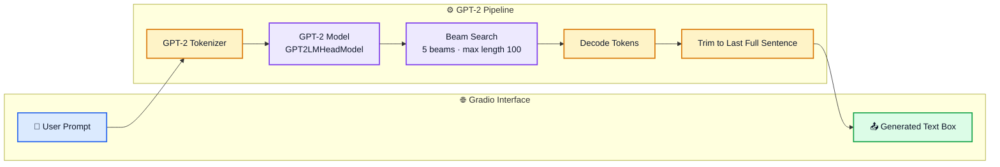

# 💬 GPT-2 Text Generation 

A Colab notebook that loads the pretrained GPT-2 language model and exposes it through a simple Gradio web interface. Type a prompt, get a generated continuation.


## ✨ Features

- Text completion using GPT-2
- Beam search decoding for more coherent output
- Output trimmed to the last complete sentence
- Interactive web UI with Prompt box, Generated text box, **Clear**, **Submit** and **Flag** buttons
- Public share link created automatically on Colab

## 🛠 Tech Stack

- Python, PyTorch
- Hugging Face `transformers` (`GPT2LMHeadModel`, `GPT2Tokenizer`)
- Gradio
- Google Colab (T4 GPU)

## ⚡ Getting Started

1. Open `textgen.ipynb` in Google Colab.
2. Select a GPU runtime.
3. Run all cells and open the Gradio link printed at the bottom.

Installs used:

```bash
pip install -q gradio
pip install -q git+https://github.com/huggingface/transformers.git
```

## 🚀 Usage

Load the model:

```python
from transformers import GPT2LMHeadModel, GPT2Tokenizer

tokenizer = GPT2Tokenizer.from_pretrained("gpt2")
model = GPT2LMHeadModel.from_pretrained("gpt2")
```

Launch the app:

```python
gr.Interface(
    fn=generate_text,
    inputs=gr.Textbox(lines=2, label="Prompt"),
    outputs=gr.Textbox(label="Generated text"),
    title="GPT-2",
).launch()
```

## 🎛 Generation Settings

| Parameter | Value | Purpose |
|-----------|-------|---------|
| `num_beams` | 5 | Beam search width |
| `max_length` | 100 | Maximum tokens generated |
| `no_repeat_ngram_size` | 2 | Avoids repeating word pairs |
| `early_stopping` | True | Stops when beams finish |

## 🖥 Demo

Example prompt: *"are machine intelligent than human being"*. The model continues with a short paragraph about AI and its future.

## 🔄 Workflow



## ⚠️ Notes

- Generation takes around 20 seconds per prompt.
- GPT-2 is a small model, so outputs can be repetitive or factually wrong.
- Gradio share links are temporary and last about 1 week.
- Set `HF_TOKEN` to avoid rate-limit warnings on download.

## 📄 License

MIT License
## 👤 Author

**Samarth Nerurkar**

- GitHub: [@samarthnerurkar](https://github.com/samarthnerurkar)
- LinkedIn: [Samarth Nerurkar](https://www.linkedin.com/in/samarth-nerurkar/)
